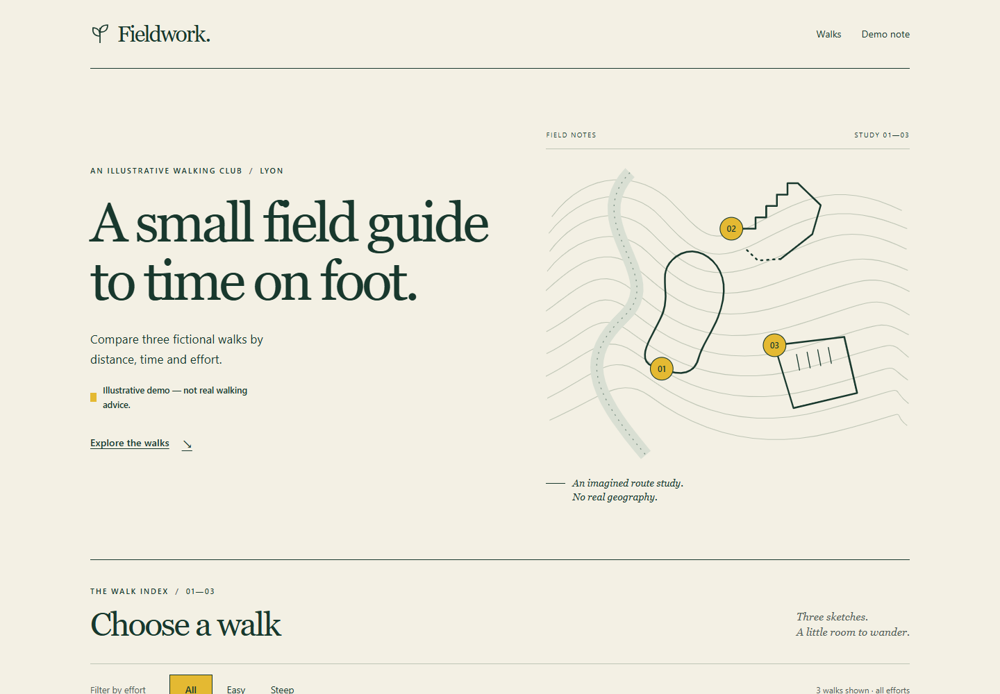
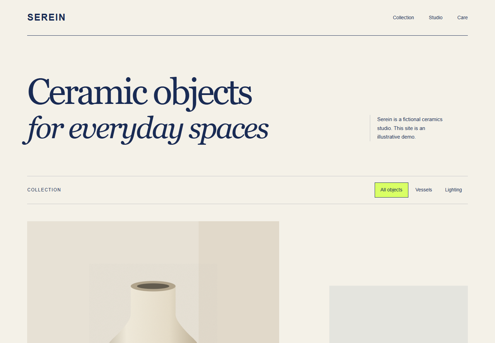

# Human Taste

Design a website around your audience, content, and preferences through a creative conversation with your AI agent.

Human Taste helps you choose a coherent direction, work through the page from header to footer, and approve a specific brief before the agent builds. Typography, composition, imagery, copy, and interaction should serve your project. Restrained and expressive designs are both welcome; no signature house style is imposed.

**Free and open source · CC BY 4.0 · Skill identifier: `human-taste`**

[See the examples](#see-what-it-produces) · [Check technology support](#check-your-technology) · [Install](#install-in-your-project) · [Start a project](#start-with-your-project)

## See what it produces

These fictional demo websites were built in independent, scripted Human Taste trials. The agent selected a buildless approach for the new site and retained React/Vite for the existing application.

| New project: Fieldwork | Existing codebase: Serein |
| --- | --- |
|  |  |
| [Full page](validation/screenshots/fieldwork-desktop.png) · [Mobile](validation/screenshots/fieldwork-mobile.png) | [Full page](validation/screenshots/serein-desktop.png) · [Mobile](validation/screenshots/serein-mobile.png) · [Before redesign](validation/screenshots/serein-before-desktop.png) |

The repository contains the skill and its test examples. It is not a mandatory website template or frontend starter.

## Decide whether it fits your task

Use Human Taste for a new website or substantial visual redesign when collaborative art direction would help. Choose guided decisions, detailed section-by-section collaboration, or agent-led exploration.

Bring an existing brand system or approved design if you have one. The agent preserves settled choices and asks only about meaningful gaps. A small fix stays a small fix; it does not trigger a complete interview.

You can say **“Choose for me”** or **“Surprise me,”** skip a creative question, or revisit a decision. Delegation still ends with a brief you can review. The skill does not promise a measurable “less AI-generated” score.

With **“Surprise me,”** the agent first asks what kind of surprise fits your project: for example **bold and expressive**, **classic and refined**, **playful and unexpected**, or **quiet and minimal**. It explains the design consequences and adapts the shortlist to the question tool's limits, with custom answers and **“True surprise — choose everything”** available. If you already supplied a preference, it uses that answer.

Choose **true surprise** to delegate every remaining creative decision: the overall concept, typography, colors, sections, imagery approach, draft copy, motion, interactions, and mobile composition. The agent chooses one coherent direction and an appropriate technical approach within your constraints, without further aesthetic questions or a section-by-section questionnaire. You can request this directly: **“Surprise me completely; choose everything.”** It asks only about essential missing facts, then presents one complete brief for your approval before building. Existing brand rules, factual accuracy, scope, and publication permissions still apply.

## Check your technology

Human Taste provides a framework-agnostic design and implementation workflow. It does not bundle framework adapters, starter projects, or a fixed dependency list. The technologies below can be used when they fit the project and your agent has the necessary tools and access. A listing is not a claim that every framework or version has been tested.

| Technology or project type | Examples | How Human Taste approaches it |
| --- | --- | --- |
| Browser foundations | Semantic HTML, modern CSS, JavaScript, native browser APIs | Prefer platform capabilities and the smallest appropriate amount of JavaScript. Check audience compatibility and fallbacks. |
| Buildless websites | Plain HTML/CSS/JavaScript on static hosting | A suitable starting point for modest presentation sites and browser-local interactions. **Tested with Fieldwork.** |
| JavaScript and TypeScript frontends | React, Vite, Next.js, Vue, Nuxt, Svelte, SvelteKit, Angular | Inspect and preserve the existing framework, components, routes, and build tooling. **React/Vite preservation tested with Serein; other examples have not been trialed here.** |
| Static generators and content sites | Astro, Eleventy, Hugo, Jekyll | Consider repeated content, authoring needs, and static output before recommending a generator. Preserve one already in use. |
| Server-rendered applications | Django templates, Flask/Jinja, Laravel/Blade, Rails/ERB, ASP.NET/Razor | Work within the existing templates, assets, routes, and application conventions. A visual redesign does not authorize rewriting backend behavior. |
| CMS-driven websites | WordPress themes or an existing CMS-backed frontend | Respect the editing workflow and theme/component system. Propose a CMS only when content ownership and editing requirements justify it. |
| Styling systems | Plain CSS, Sass, CSS Modules, Tailwind CSS, Bootstrap, existing design tokens | Reuse established conventions and brand rules; do not replace the styling system merely to change the visual direction. |

For a **new project**, the agent recommends technology from functionality, content editing, hosting, browser audience, and maintenance needs. For an **existing codebase**, it inspects manifests, lockfiles, entry points, routes, styles, and checks before proposing changes. The selected or retained stack and its rationale become part of the brief. Framework migrations, new services, and dependencies need a concrete reason and authorization within the project scope.

### Choose your agent

Installation is supported through the [open `skills` CLI](https://github.com/vercel-labs/skills):

| Agent | Installer identifier | Verification here |
| --- | --- | --- |
| Claude Code | `claude-code` | Local copy installation checked; conversational behavior not tested |
| Codex | `codex` | Local installation checked; independent scripted website trials completed |
| Cursor | `cursor` | Shared project installation path checked; conversational behavior not tested |

Question tools vary by client and mode. The skill uses permitted clickable multiple-choice tools when available and concise numbered choices otherwise. It has no required question-tool plugin.

## Install in your project

You need Node.js and npm. Check the [installer's current prerequisites](https://github.com/vercel-labs/skills#install-a-skill), then run this from your website project's directory:

```sh
npx skills add TulossSolutions/human-taste --skill human-taste --agent claude-code codex cursor --copy
```

Keep only the agent names you use. Add `--global` to install across projects. `--copy` avoids requiring symlink privileges; on Windows, use `npx.cmd` if PowerShell blocks the `npx.ps1` launcher.

To inspect discovery before installing:

```sh
npx skills add TulossSolutions/human-taste --list
```

If you downloaded or cloned this repository, you can use its absolute local path instead of `TulossSolutions/human-taste`. Run the command from the website project where you want the skill installed.

Human Taste itself is Markdown with optional Codex display metadata. The external installer handles distribution; no custom npm package, framework, or runtime library is required by the skill.

## Start with your project

For a new website:

> Use Human Taste to design and build a website for my bicycle workshop. Help me choose an appropriate technical approach and walk through the creative decisions before building.

For an existing codebase:

> Use Human Taste to redesign this website. Inspect the existing application first. Keep its framework, working functionality, logo, and brand colors. Propose a direction and show me the brief before building.

To delegate creative details:

> Use Human Taste for this portfolio. Choose the remaining creative details for me within the supplied constraints, then show me the brief for approval.

Bring whatever you already have: purpose, audience, primary visitor action, content, references, brand assets, and practical constraints. The agent should read available project context rather than asking you to repeat it. Missing facts remain questions; they are not creative choices to invent.

## Shape the direction, then approve the brief

1. **Establish the starting point.** Inspect the project and resolve missing purpose, content, audience, functionality, and technical constraints.
2. **Choose a direction.** Compare project-specific typography, composition, palette roles, imagery, copy voice, and motion, with concrete examples and tradeoffs.
3. **Work through the page.** Make the unresolved decisions from header to footer. Remove or combine sections when the content calls for it.
4. **Review the brief.** Check the structure, representative copy, responsive behavior, accessibility, technology, dependencies, and acceptance criteria. Explicitly approve it before implementation.
5. **Build and review.** The agent implements within that brief, checks the rendered result where tools permit, and reports remaining dependencies and unverified areas.

Questions come in small rounds. The decision record separates your choices, delegated decisions, pending proposals, missing assets, and rejected directions. Changing a choice updates the affected brief; ordinary implementation details within an approved scope do not require repeated permission.

The skill does not fabricate testimonials, customers, metrics, scarcity, capabilities, or completed work. Draft copy and placeholders stay visible. Approval to build does not automatically authorize publication.

## Review the evidence

[The live test report](validation/LIVE-TESTS.md) includes the two scripted trials, site sources, nine real browser screenshots, a reproducible harness, and the recorded results:

- **39 browser/preservation checks passed**, covering four viewport widths, filters, disclosures, forms, dialog behavior, focus, and existing-file preservation.
- The existing application’s **two data tests and production build passed**.
- Automated accessibility scans and a separate contrast follow-up are documented alongside visual inspection and known limits.

The existing application was a seeded React/Vite fixture. Tests used Chrome, not physical phones or every browser. Claude Code/Cursor conversational behavior and the other technology examples above have not been tested. These results establish the reported behaviors, not universal design quality or framework compatibility.

The [initial review](validation/REVIEW.md) retains structural/installer checks and seven manual scenario walkthroughs. Structural validation, observed conversations, browser checks, and aesthetic judgment are reported separately.

## Explore or adapt the skill

| File or directory | What you will find |
| --- | --- |
| [human-taste/SKILL.md](human-taste/SKILL.md) | Discovery metadata and the complete workflow |
| [Section interview reference](human-taste/references/section-interview.md) | Conditional prompts and examples for page sections |
| [Decision and brief reference](human-taste/references/decision-and-brief.md) | Decision record and approval brief |
| [Codex metadata](human-taste/agents/openai.yaml) | Display name and example invocation |
| [Validation report](validation/LIVE-TESTS.md) | Executed checks, limitations, and reproduction instructions |
| `validation/fixtures/`, `validation/browser/`, `validation/screenshots/` | Demo sources, browser test code/results, and actual captures |

Supporting references load when useful. [GoogleChrome/modern-web-guidance](https://github.com/GoogleChrome/modern-web-guidance) supplies maintained technical guidance for implementation decisions; it is not an installed dependency or an aesthetic prescription. The agent retrieves relevant current material and discloses when live compatibility verification is unavailable.

## Use, share, and modify

Human Taste is licensed under [Creative Commons Attribution 4.0 International](https://creativecommons.org/licenses/by/4.0/), SPDX identifier `CC-BY-4.0`. See [LICENCE](LICENCE); the installed skill retains its own [license notice](human-taste/LICENCE).

You may use, share, and adapt these instructions, including commercially. When sharing, retain supplied attribution, link to the license, and indicate modifications. Suggested credit: “Human Taste contributors — Human Taste — CC BY 4.0,” with a link to the source you received.

The license covers this repository's original material. It does not automatically license a generated website or third-party fonts, images, code, or content. External projects retain their own licenses.
