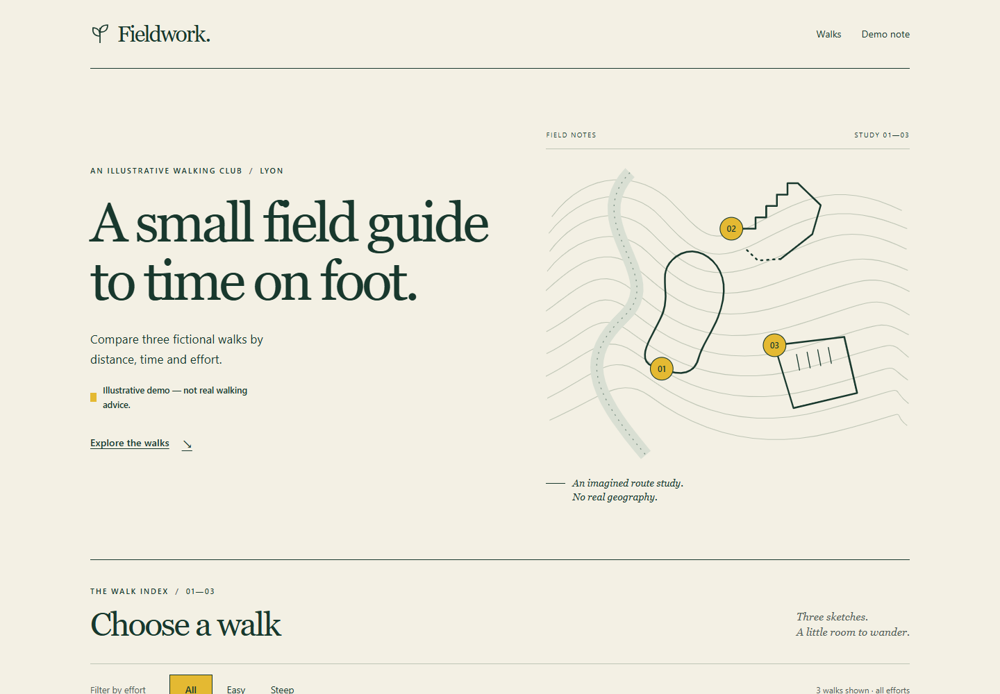
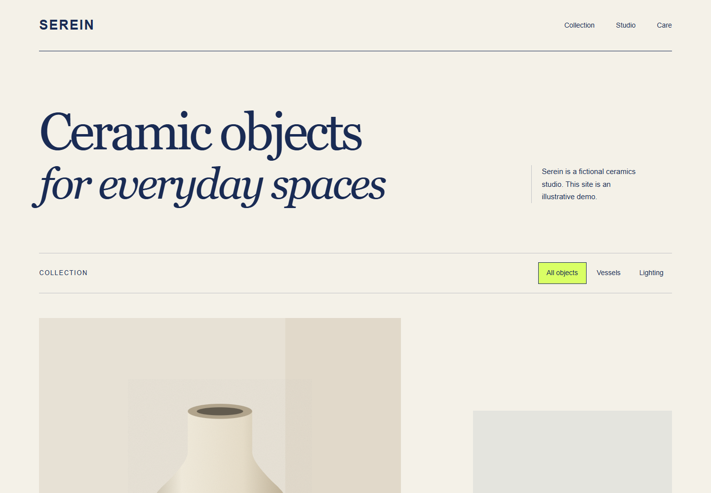

# Human Taste live website trials

Completed 2026-11-15. The updated skill was exercised by two independent Codex agents with scripted user replies. They produced actual local websites, which were rendered and tested in headless Chrome. These are fictional fixtures, including a deliberately seeded existing codebase, rather than tests against a production customer site.

## Technology selection

The skill now explicitly inspects the technical starting point before recommending technology. It distinguishes new projects from existing applications and new folders inside larger repositories. It records inspected evidence, stack rationale, commands, hosting constraints, and preserved behaviors in the brief, before setup or migration.

| Trial | Inspected starting point | Result |
| --- | --- | --- |
| Fieldwork | Empty isolated project; static hosting; three fictional routes and local filters/details | Chose buildless HTML/CSS/JavaScript, no packages or external runtime assets |
| Serein | Seeded React 19.2.0 / Vite 7.2.2 app, npm lockfile, brand tokens, product data, care page, filters, native inquiry dialog and tests | Retained the framework, dependencies and working interactions; redesigned `src/App.jsx` and `src/styles.css` |

The full scripted records are [Fieldwork's evaluation](fixtures/new-site/EVALUATION.md) and [Serein's evaluation](fixtures/existing-site/EVALUATION.md). They retain the brief, user choices, delegation, approval state, and sources actually consulted. Agent-only completion messages distinguish their source checks from the evaluator browser checks reported here.

## Observed interview behavior

- **Detailed collaboration:** Fieldwork presented coherent directions, then opening/comparison choices, before its concrete brief.
- **Delegation and existing branding:** Serein inspected the existing project and proposed one gallery direction within the supplied brand and technical constraints. It paused before implementation.
- **Revision:** Fieldwork replaced the rejected clay accent with yellow while retaining the chosen notebook direction.
- **Missing proof and imagery:** Neither site invented testimonials, real customers, metrics, or photographs. Fieldwork used clearly fictional schematics; Serein reused supplied fictional object illustrations.
- **Text-only environment:** The evaluators used numbered choices because clickable question tools were deliberately excluded from the trial.
- **Actual-answer gate:** Fieldwork received only `{"accepted":true}` after its brief. It explicitly remained pending, and filesystem inspection confirmed only its evaluation document existed. It began implementation after the evaluator submitted an explicit scripted approval. Serein also awaited explicit approval of its brief.
- **Small change:** After Fieldwork was built, a scripted request changed only “Back to top” to “Return to top.” The agent made the single label replacement without restarting the interview or changing the destination, styles, or scripts. The browser check confirmed the link still targets `#top`.

These are observed responses from the two evaluation agents, not measurements of reliability across models or clients. Scripted approvals are test inputs; no claim is made that a real customer approved either fictional design.

## Browser and source checks

**39 recorded checks passed**, including five independent SHA-256 preservation checks. The Serein agent additionally verified all 12 protected files against its recorded baseline. Its two existing data tests and production build passed before and after redesign. The copied Fieldwork script also passes `node --check`.

Environment: Chrome **152.0.7977.83**, Playwright Core **1.65.1**, axe-core **4.14.0**, Node **25.0.0**, Windows. Layouts were checked at **1440, 768, 390, and 320 CSS pixels**; screenshots use 1440 × 1000 and 390 × 844 viewports at device scale 1. Mobile screenshots are browser viewport checks, not physical-device tests.

| Area | Checks actually performed |
| --- | --- |
| Rendering | Both pages load; meaningful titles; one main landmark and one h1; no horizontal overflow at four widths; no uncaught browser errors or failed application-resource responses captured by Playwright |
| Keyboard/motion | Visible initial keyboard focus; native radio-arrow navigation and Enter-operated disclosures; reduced-motion preference leaves opening content visible |
| Fieldwork | All/easy/steep filtering returns 3/2/1 routes; result announcements; multiple open route sheets; mobile filter/disclosure operation; all routes and native disclosures remain usable without JavaScript |
| Serein | Original collection filters return 3/2/1 objects; required and invalid-email validation; honest local success; Escape and close button; focus restoration; reset on reopening; mobile inquiry; care page and return navigation |
| Preservation | Package manifest, lockfile, product data, care page and original tests match independent baseline hashes; agent also checked the original dialog, entry files, brand and SVGs |
| Accessibility | axe WCAG 2/2.1 A/AA tagged checks found zero violations on both main pages and the open inquiry dialog; 25 passing rules for Fieldwork, 21 for Serein |

One Fieldwork axe rule returned **incomplete**, covering three SVG numbers and a decorative footer arrow. Source and rendered inspection confirmed the actual background surfaces; calculated contrast was **6.87:1** for the numbers and **11.20:1** for the arrow. The raw incomplete result is retained. This follow-up does not turn the scan into a complete accessibility audit.

The dialog-reset test waits for React's committed reset before asserting the status disappears. A first synchronous assertion was timing-sensitive; the harness was corrected without changing the application.

Raw results: [browser-results.json](browser/browser-results.json). Reusable harness: [browser-checks.mjs](browser/browser-checks.mjs). The evaluator visually inspected the rendered desktop/mobile compositions and inquiry screenshot; automated results are separate from aesthetic judgment.

The local server logs also recorded the browser's automatic `/favicon.ico` request returning 404 on both fixtures. Playwright's page response stream did not include those requests, so the harness's raw "no failed HTTP responses" check covers the resources it tracked, not every background browser request. Neither fixture supplies a favicon; this does not prevent its page assets or interactions from working.

## Screenshots

These are actual browser captures, not generated mockups. Click the full-page or mobile links to inspect the complete layout.

| Site | Desktop | Mobile | Interaction / baseline |
| --- | --- | --- | --- |
| Fieldwork | [First screen](screenshots/fieldwork-desktop-viewport.png) · [Full page](screenshots/fieldwork-desktop.png) | [Full page, 390px](screenshots/fieldwork-mobile.png) | [Expanded route sheets](screenshots/fieldwork-route-details.png) |
| Serein | [First screen](screenshots/serein-desktop-viewport.png) · [Full page](screenshots/serein-desktop.png) | [Full page, 390px](screenshots/serein-mobile.png) | [Inquiry state](screenshots/serein-inquiry.png) · [Before redesign](screenshots/serein-before-desktop.png) |

### Fieldwork — new project



### Serein — existing-codebase redesign



## Reproduce locally

The [Fieldwork fixture](fixtures/new-site/index.html) is buildless. The [Serein fixture](fixtures/existing-site/package.json) includes its original locked dependencies; `node_modules` and generated build output are not bundled. Browser libraries are isolated under `validation/browser`, outside the installed skill.

From the repository root, prepare the existing app:

```powershell
npm.cmd --prefix validation/fixtures/existing-site ci --no-audit --no-fund
npm.cmd --prefix validation/fixtures/existing-site test
npm.cmd --prefix validation/fixtures/existing-site run build
```

Start these servers in two terminals:

```powershell
python -m http.server 8765 --bind 127.0.0.1 --directory validation/fixtures/new-site
python -m http.server 8766 --bind 127.0.0.1 --directory validation/fixtures/existing-site/dist
```

Install the isolated browser dependencies and run the harness:

```powershell
npm.cmd --prefix validation/browser ci --no-audit --no-fund
npm.cmd --prefix validation/browser test
```

The harness uses the standard Windows Chrome executable path. Set `BROWSER_EXECUTABLE` to another compatible Chromium executable when needed. It does not download a browser. Results and screenshots are written under `validation/browser` and `validation/screenshots`. Stop the local servers with Ctrl+C when finished.

## Limits and scope

Firefox, Safari/WebKit, physical phones, screen readers, actual clickable interview tools, and Claude Code/Cursor conversational behavior were not tested. Reduced-motion checks verify content visibility; neither design adds animation. These two examples do not establish a universal aesthetic style or a numerical taste score.

The initial [structural/manual review](REVIEW.md) remains a record of the first delivery. This follow-up supersedes its earlier statements that no independent evaluation or websites had been produced. The skill update and local test artifacts fulfill the follow-up request; no business services, production application, public deployment, tracking, or account configuration was added.
