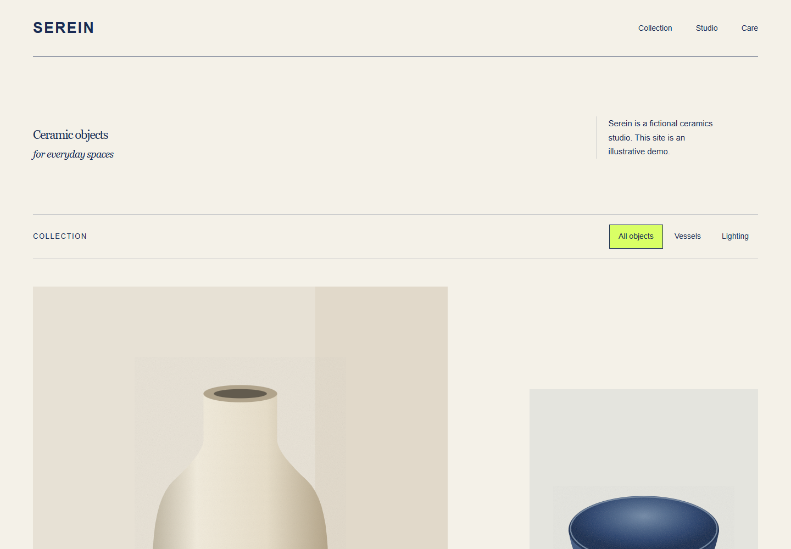
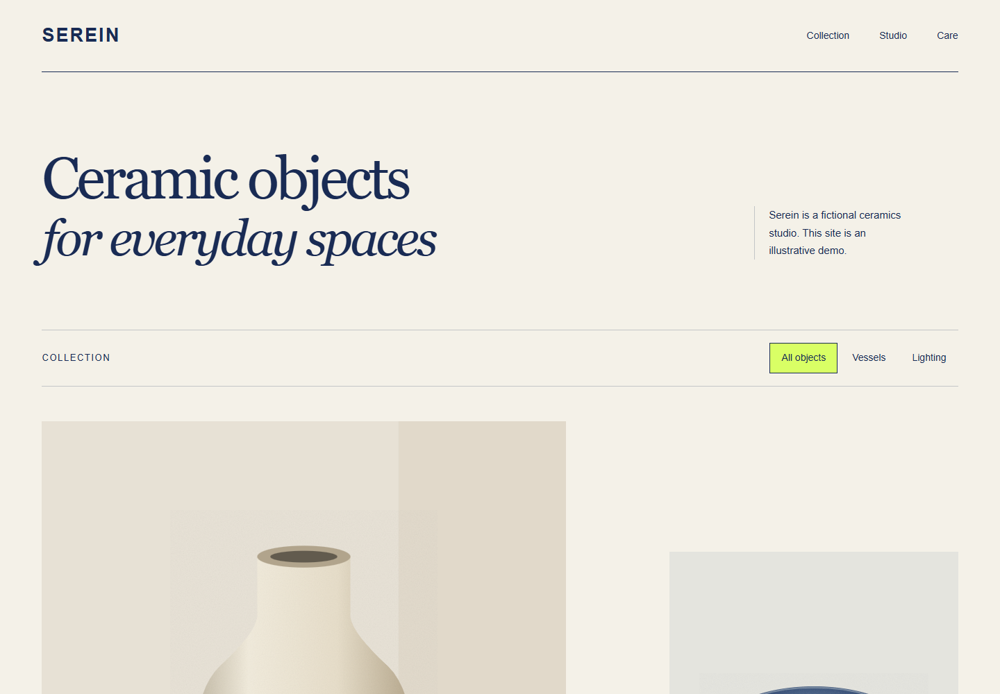
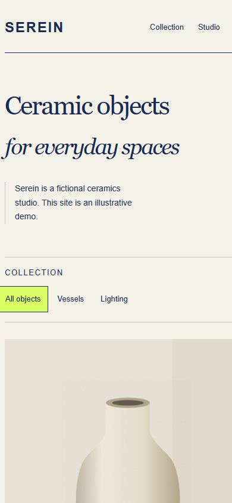
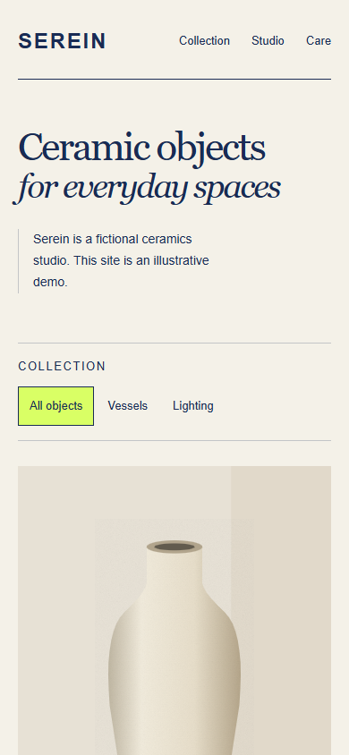

# Visual-refinement trial

Completed 2026-11-17. An independent Codex agent used the updated Human Taste skill on an isolated, fictional Serein screen. This extends the earlier [website trials](LIVE-TESTS.md) with a bounded refinement test; the earlier fixtures and results remain unchanged.

## Scenario and observed behavior

The evaluator copied the existing React/Vite fixture into independent `before` and `after` projects and seeded visual roughness: a 430px body minimum, narrow gutters, weak desktop heading hierarchy, and an excessive desktop image/caption gap. It supplied rendered desktop/mobile baselines before implementation. The fixture still had working filters, inquiry states and care navigation.

The scripted request authorized CSS-only refinement while preserving the existing direction, copy, colors, fonts, images, destinations and behavior. It delegated aesthetic details and excluded new effects, features, dependencies, services and publication. This was a concrete bounded correction request, not approval to redesign the product.

The agent used the refinement route, inspected the baseline, recorded ordered issue/change/reason decisions and proceeded without a new creative questionnaire. It retained content and imagery, corrected composition/type relationships, rejected unnecessary effects, and stopped after its scoped changes and source checks. It changed only `src/styles.css` among the 14 baseline files, plus authored the requested [evaluation record](refinement/after/EVALUATION.md).

This is observed scripted-agent behavior in one seeded fixture, not a measurement of reliability across all clients, projects or models. Broad refinement requests without an existing approval or bounded scope still require a compact refinement brief for approval; that separate branch was reviewed in the instructions, not independently exercised here.

## Comparable captures

Both phases used headless Chrome 152.0.7977.83, device scale 1, desktop viewport 1440 × 1000 CSS px and mobile viewport 390 × 844, the same supplied content, All objects selected, inquiry closed, and scroll at the top. Browser default zoom was retained.

| Before | After |
| --- | --- |
|  |  |
|  |  |

Full-page captures: [before desktop](refinement/screenshots/before-desktop.png), [after desktop](refinement/screenshots/after-desktop.png), [before mobile](refinement/screenshots/before-mobile.png), [after mobile](refinement/screenshots/after-mobile.png). The baseline mobile full-page image is 430px wide because it includes the overflowing document; both mobile **viewports** were 390px. The viewport captures above show the actual clipping difference.

## Results

The final after-state has **30 passing recorded checks**, including 13 file-preservation checks. The before-state has 22 passing baseline source/function checks and separately records its intentionally broken narrow layout. The existing application's two data tests and production build passed before and after.

| Observation | Before | After |
| --- | --- | --- |
| Content width at 390px viewport | 430px | 390px |
| Content width at 320px viewport | 430px | 320px |
| Page gutter at 768px viewport | 8px | 32.25px |
| Desktop opening type size | 22px | 85.2px |
| Desktop image-to-caption gap | 88px | About 28.8px |
| Non-CSS baseline files | Original 13 files | All 13 SHA-256 hashes unchanged |

These measurements verify the specific corrections, not a numerical taste score. The heading and spacing changes were judged against this fixture's retained gallery direction; larger type or margins are not universal improvements.

The evaluator visually inspected desktop/mobile captures and exercised filters (3/2/1 objects), required/invalid email, honest local success, Escape/close, focus restoration, success reset on reopening, mobile inquiry, Care/return navigation, initial focus, and reduced-motion content visibility. Layout checks passed at 1440/768/390/320px. Rendered main content stayed identical. Automated axe checks found zero violations, with 21 passing rules and no incomplete results on each main-page scan.

No uncaught browser errors or failed application-resource responses were captured by Playwright. As in the original trials, the local server can receive an automatic missing-favicon request outside that page response stream; this fixture supplies no favicon. Automated accessibility checks, manual interaction checks and visual judgment remain distinct.

The first gutter comparison used the 1440px centered/max-width layout, where the actual difference was less than a pixel. The harness was corrected to compare the affected 768px layout; the table reports that meaningful measurement. Neither application source nor acceptance criteria were changed to satisfy the test.

Evidence: [before results](refinement/before-results.json), [after results](refinement/after-results.json), [baseline source hashes](refinement/baseline-hashes.json), [test harness](browser/refinement-checks.mjs). The independent implementer's record explicitly separates its source/build checks from the evaluator's subsequent browser verification.

Published CSS text is normalized to LF line endings under the repository's Git policy; the bundled baseline CSS hash reflects that normalization. The rendered rules are unchanged, and all 13 non-CSS preservation hashes remain exact.

## Reproduce

The [before](refinement/before/package.json) and [after](refinement/after/package.json) sources are included without dependencies or generated `dist` directories. From the repository root:

```powershell
npm.cmd --prefix validation/refinement/before ci --no-audit --no-fund
npm.cmd --prefix validation/refinement/before test
npm.cmd --prefix validation/refinement/before run build
npm.cmd --prefix validation/refinement/after ci --no-audit --no-fund
npm.cmd --prefix validation/refinement/after test
npm.cmd --prefix validation/refinement/after run build
```

Start each server in a separate terminal:

```powershell
python -m http.server 8775 --bind 127.0.0.1 --directory validation/refinement/before/dist
python -m http.server 8776 --bind 127.0.0.1 --directory validation/refinement/after/dist
```

Then run the before phase followed by after, so the harness can compare their recorded metrics:

```powershell
npm.cmd --prefix validation/browser ci --no-audit --no-fund
npm.cmd --prefix validation/browser run test:refinement -- before
npm.cmd --prefix validation/browser run test:refinement -- after
```

The browser harness uses the standard Windows Chrome executable path; `BROWSER_EXECUTABLE` can select another compatible Chromium executable. Results and screenshots are written under `validation/refinement`. Stop the owned local servers with Ctrl+C when finished.

## Limits

Testing covered Chromium, one fictional fixture, delegated bounded corrections, source preservation and the listed interactions. Physical devices, Safari/Firefox/Edge, screen readers, actual browser/text zoom controls, newly added motion, reference-service integrations, and other conversation modes were not runtime-tested in this trial. The existing design required no new aesthetic reference, asset, library or service. No MCP server was implemented as part of this refinement work.
